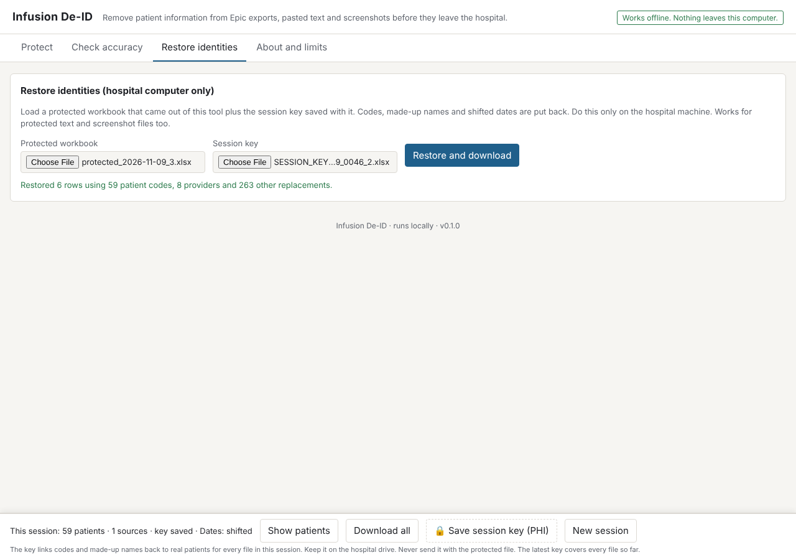
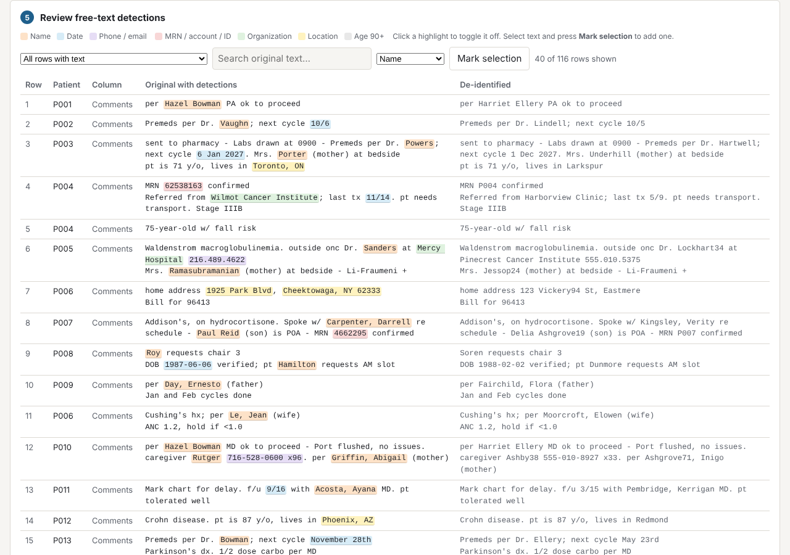

# Infusion De-ID

A single HTML file that de-identifies Epic infusion schedule and ordering exports on a locked-down work computer. No install, no admin rights, no network, no Office add-in sideloading. Open `dist/infusion-deid.html` in Edge (or Chrome), drop in the export, confirm column roles once, run, review, download.

It implements the architecture from the PHI (protected health information) detection research memo (`docs/PLAN.md` has the plan and the gaps):

| Stage | What it does |
| --- | --- |
| Schema pass | Classifies each column (patient name, MRN, DOB, account, phone, provider, date, age, ZIP, free text, keep, drop) from header and values. You confirm once; roles are remembered per report layout (headers only, in browser local storage). |
| Census dictionary | Every patient's name variants (`Last, First`, `First Last`, `F. Last`, surname, each given name of a two-word or three-part name, diminutives such as Ben/Kasia/Sal, initials `K.Y.` and `Sal P.`), MRN with and without leading zeros and with internal spaces, DOB in nine renderings, account, phone, plus provider names, become an exact-match detector over all free text. A relative who shares the surname (`daughter Siobhan Fitzgerald-Nowak`) is told apart from the patient and gets a surrogate of her own. Deterministic recall on the identifiers that matter most. |
| Tier 0 rules | MRN pattern learned from your MRN column, labelled record numbers even when split (`MRN#0041 2345`), phones with extensions, emails, SSNs and SSN last-4, URLs, street addresses with or without a suffix (`lives at 412 Delaware`, `near Brighton Rd`), town + ZIP, ages 90+ in every spelling (`91yo`, `Zofia, 95,`, `Turned 90`), dates in every Epic format (`11/7/26`, `2026-11-07`, `Nov. 7th`, `7-Nov`, `3rd of Jan`, `11/13`). Cycle fractions (`1/2 dose`, `Cycle 1/2`) and symptom scores (`pain 6/10`) are not dates. A birthdate written in a note follows the DOB setting (removed by default). |
| Tier 1-lite | Large frequency-tiered lexicon (Census 2000 surnames, SSA first names: 190k names, built by `tools/build-lexicon.js`) plus a cue detector for names, organizations, locations: honorifics, credentials (`Smith, J NP`), relationship words (`pt's son Mark`, `Mark (son)`), contact verbs (`Called Xiomara at 315-…`), facility words and acronyms (`Kenmore Mercy`, `ECMC`), `City, ST`. Clinical eponyms and drug names are protected (Hodgkin, Bell's, Graves, Ann Arbor, Keytruda…). |
| Post-processing | Overlap resolution by priority, name merging, document-wide propagation of every detected name, sentence-boundary awareness. |
| Hide in plain sight | Realistic surrogate names from one allocator per session: a made-up name is never handed to two people, whether patient, doctor, relative, street or organization, across every input, and a saved key seeds the allocator. Per-patient date shifting (±30–365 days, intervals preserved), age banding, 3-digit ZIPs, fake organizations and cities, `555-010-xxxx` phones (bare 10-digit numbers too). MRN → `P001` study code. |
| Self-check and audit | Before any download the page re-scans every output cell, and the column headings (which are protected like any cell: a key/value sheet or a title row read as the header puts patient details there), with a deliberately over-sensitive check: digits only (so a spaced or hyphenated MRN is found), every name token, diminutive and initial of every patient, ages 90+ as bare numbers, and phone/e-mail/SSN shapes the surrogates never produce. A hit, or a patient whose name could not be read from pasted text or a screenshot, blocks the download. A `DeID Audit` column per row: patient code, counts by type, counts by layer; the date offset lives only in the session key. A run summary (`.txt`, no PHI) and the session key (`.xlsx`, **PHI**, one per session covering every input) are separate downloads. |
| Review | Highlighted detections per cell; "lines need a look" lists only the places found from a word clue alone (or text the screenshot reader was unsure of), with the count of certain replacements shown beside it. Click a highlight to drop it, select text to add one. Edits re-run the pipeline with the same seed so surrogates stay consistent. A patient's own identifier is locked and cannot be un-hidden. |
| Session registry | One patient registry per page session: the same real patient (matched by MRN with leading-zero and OCR-confusion normalisation, then name + DOB, then a close name) keeps one code, one surrogate and one date offset across spreadsheets, pasted text and screenshots. A saved key can seed a later session. |
| Text and screenshots | Pasted text and OCR output become a per-line table (name, MRN, DOB carried forward to following lines; `===` starts a new section) and run through the same pipeline. The OCR build reads screenshots in the page with Tesseract.js, offline. |
| Re-identify | Load the de-identified workbook plus the mapping key on the hospital machine to restore MRNs, names (ALL-CAPS cells included), providers without doubled credentials, relatives, organizations and dates. |
| Validate | Built-in synthetic stress set with exact ground truth, per-category token and entity recall with bootstrap 95% CIs, over-redaction rate, leak check, the memo's adversarial cases, and a layer ablation. |




## Using it on a work computer

Three actions: **drop, glance, download.**

1. Copy `dist/infusion-deid-ocr.html` to the machine (email it to yourself, USB, shared drive). It is one file, about 11 MB, and handles exports, pasted text and screenshots. `dist/infusion-deid.html` (3.6 MB) is the same without the screenshot reader. If you need to protect **screenshots**, copy `dist/infusion-deid-ocr.html` instead (about 9 MB; it carries an offline text reader). Double-click to open in Edge or Chrome. The page runs locally. Its Content-Security-Policy (`default-src 'none'`, `connect-src 'none'`) blocks network requests in current Chrome, Edge and Firefox, and the end-to-end test asserts that no request leaves the page. That is a browser guarantee, not a promise about what you do with the files you save.
2. **Drop** an Epic export (`.xlsx`/`.csv`), a Snipping Tool screenshot, or a `.txt` file onto the page, or paste text with Ctrl+V. There is no mode to pick: the page tells a spreadsheet from a screenshot from a note by its content and starts work at once. Title rows above the header are detected. Drop more files to add them to the same session: the same patient keeps the same code, made-up name and date shift across every file.
   **Patient list (recommended for pasted text and screenshots).** `Patient list…` next to `Paste text…` (and *Add patients…* in the session panel) takes today's schedule or roster: paste one patient per line (`Last, First  MRN  DOB`, or `First Last` with or without the record number), or choose the roster export (`.xlsx`/`.csv`; name, split last/first, MRN and DOB columns are recognised). The list makes no protected file of its own and is kept in the tab's memory only; it tells the session who today's patients are, so their names, record numbers and birthdates are replaced wherever they appear and the check before download looks for each of them. Everything already protected is run again when the list changes. The strip at the bottom shows `Patient list: N patients`.
3. **Glance** at the verdict. There are three:
   - **Release check passed** – the page re-scanned its own output for every real name, nickname, initial, MRN, phone, account number and birthdate it knows, in any spacing it can predict, found none, and an independent release scan (written apart from the detectors) found no identifier-column value and no unrecognised source word surviving. The download button sits in the verdict.
   - **Review required** – downloads stay off until you press *I have reviewed this*. It appears when text or a screenshot was protected with no patient list (names were found by rules only), or when source words survived that are not ordinary or medical words (for example a name in a column you chose to keep). Each such word is listed and links to its line. The acknowledgement belongs to that exact result: any change (settings, patients, your edits, a re-run) needs a new review.
   - **Blocked** – something identifying still appears (listed, each with *Show*), a line has a record number but no legible name, a spreadsheet has no patient column, or protecting failed. Nothing from that input downloads, and neither does *Download all*, until it is fixed (or the compliance override is on, which the run report records).
   A failed run leaves the session's patient registry exactly as it was before the run. Below the verdict, "lines need a look" are places found from a word clue or by the strict pass (an unrecognised capitalised word, which may be an ordinary word); tap a highlight if it is not patient information, or select text and press *This is patient info*. The first time a report layout is seen, a one-line sentence says how each column was treated; when something looks risky, the card turns amber and asks you to confirm before downloading.
4. **Download** the protected file. Every download (xlsx, CSV, text, run report, *Download all*, a single source from the session panel) goes through one release step: it asks again whether the input may leave and whether the result is still the one that was checked, builds the file, reads the written bytes back with an independent reader, and checks them (same sheets and cells, no formula cells, no identifier-column value anywhere). If any check fails, nothing is saved. It is named `protected_<date>_<n>.xlsx`, never after the source file, and its audit column carries counts only, never the date offset. No cell of any file the page writes (xlsx, CSV, text, *Download all*, restored files, the key) can start a spreadsheet formula: a text cell beginning with `=`, `+`, `-`, `@`, a tab or a carriage return is written with a leading apostrophe, the CSV copy quotes every field holding a quote, comma or line break (a bare carriage return included, so a break inside a cell never starts a new record), and the text copy guards every line. The run summary lists the columns by their protected headings, never the input's (a heading can hold patient details), and follows the same gate as every other download. The **session key** (`SESSION_KEY_PHI_<date>_<time>_<k>.xlsx`, the counter continues when a session is restored from a key) is a separate button on the strip at the bottom of the page, marked with a lock and the word PHI: it links codes and made-up names back to real patients for every file in the session, and it stays on the hospital drive. *Download all* writes one workbook with a sheet per source.

Long exports (more than 1,200 rows) are protected in parts: every patient of the whole file is registered first, then the rows are protected part by part and the result checked slice by slice, with progress shown (`Protecting row 1,800 of 20,000…`) and the page answering between steps; *Stop* ends the run and leaves nothing downloadable from that input. A name found only from a word clue is spread to other lines of its own part only. Each step is sized from what a call costs at the session's size (a fixed part that grows with the patients the session knows, plus a cost per row), so no step freezes the page for long. One page protects at most 50,000 rows, 1,000 columns and 10,000 distinct patients per session (measured: 10,000 patients in 17 s, the page never still for more than about 2.5 s), pasted or `.txt` text up to 10,000 lines and 3 MB, and reads CSV files up to 8 MB and workbooks up to 15 MB; a larger input is refused at once with a request to split it (save the key and start a new session when one is full). A sheet's range is taken from its real cells, never from the dimension it declares.

Screenshots: the recognised text is shown in an editable box ("What the screenshot says"); fix misreads and press *Use my corrections*. Lines the reader was unsure about are flagged *Unclear in screenshot*. Only the text is protected; the image itself is never written anywhere and must not leave the hospital.

Under **Advanced**: how names appear (made-up names or codes), the release profile: *Research (pseudonymized)*, the default, shifts dates per patient with intervals kept, which is NOT Safe Harbor; *HIPAA Safe Harbor* removes every date, keeps at most the birth year (none for ages 90+), groups ages 90+, and truncates ZIPs to 3 digits with the 17 restricted prefixes written as `000`. The run report names the profile. Safe Harbor also requires that you have no actual knowledge the remaining data could identify someone; the tool cannot decide that for you, *Always remove* for your hospital, clinic and department names, *Never remove* for local vocabulary. Settings and word lists are remembered on the computer; patient data never is. The made-up names and date shifts are drawn from a number chosen at random for each session and kept only in the session key (a restored session draws the same ones); the *Consistency number* is empty by default, applies to the current session only and is never saved. A drawn date shift never leaves a date written without a year within the minimum shift of where it was (an offset near a whole year is drawn again). **Restore identities** takes a protected file plus the session key and puts the real values back, on the hospital machine only. **Check accuracy** scores the detector on an invented report.

## Measured on the synthetic set

`node test/run_eval.js` on 600 rows × 4 seeds (token recall; 95% bootstrap CI). `node --test test/unit.test.js` also runs a 40-cell red-team corpus (nicknames, relatives, spaced MRNs, bare ages, addresses, employers) as a table and row by row, and the self-check against the raw and protected output.

| Category | Recall | Notes |
| --- | --- | --- |
| Names (patient, relative, provider; in- and out-of-lexicon) | 99.9–100% | out-of-lexicon names caught only when a cue is present |
| MRN, account, phone, email, dates, ages 90+ | 100% | rules + census |
| Organizations | 100% | synthetic facilities only; real local names need the always-redact list |
| Locations | 100% | `City, ST`, prepositions, addresses |
| Over-redaction | 0.0–0.1% of non-PHI tokens | eponyms and word-names (Will, Hope, Grace) stay |
| Structured leaks (real MRN, name, phone or account anywhere in output) | 0 | checked on every run |

**These numbers are an upper bound.** The generator and the detector were written by the same hands, and the generator's fragments share vocabulary with the detector's cues. The number that counts is the gold set on your own reports (see `docs/PLAN.md`). Layer ablation on the same set shows what each tier buys: without the census dictionary, name recall drops to ~93%; without the lexicon/cue tier, names fall to ~57% and organizations to ~2%. That delta is the argument for the architecture.

Known gap: an out-of-lexicon surname with no cue at all (`Vanterpool called about labs`) is missed. That is the slot for the compact clinical transformer (Tier 1) from the memo; this build does not carry one.

## Measured on blind red-team cases

Twelve measurement-only rounds (fresh blind cases written by agents that cannot see the code or earlier cases, scored once, no fixes before scoring), 92 cases each:

| Version measured | Ordinary comments leaking | Hard comments leaking | Screenshots leaking |
| --- | --- | --- | --- |
| v0.2 (round 5) | 10 of 56 (18%) | 12 of 24 | 0 of 12 |
| v0.3 (round 6) | 3 of 56 (5%) | 10 of 24 | 3 of 12 |
| v0.4 (round 7) | 5 of 56 (9%) | 4 of 24 | 3 of 12 |
| v0.5 (round 8) | 0 of 55 (0%) | 9 of 25 | 1 of 12 |
| v0.6 (round 9) | 1 of 56 (2%) | 5 of 24 | 2 of 12 |
| v0.8 (round 10) | 3 of 56 (5%) | 14 of 24 | 0 of 12 |
| v0.9 (round 11) | 3 of 56 (5%) | 6 of 24 | 4 of 12 |
| **v0.10 (round 12)**: strict pass + release scan | **0 of 56 (0%)** | **4 of 24** | **0 of 12** |
| **v0.10 + round-12 fixes (round 13)** | **0 of 55 (0%)** | **6 of 25** | **3 of 12** |
| **v0.10 + round-13 fixes (round 14)** | **1 of 56 (2%)** | **2 of 24** | **0 of 12** |
| **v0.10 + round-14 fixes (round 15)** | **1 of 56 (2%)** | **3 of 24** | **1 of 12** |
| **current build, no fixes since (round 16)** | **0 of 56 (0%)** | **3 of 24** | **1 of 12** |

Round 12's four leaks were all hard cases: a pump serial a few words after its label, a personal page as a bare-domain URL, the first name *Will* reused as an ordinary word ("Will will return"), and a nickname in brackets ("Patrick (Paddy)"). All four are fixed since with general rules and kept as regression cases. The scorer still lists m12-text-36 because it matches the ordinary lower-case "will" that stays in the output. Round 15 is the clean measurement of the current build: no change was made after it was scored. It leaked 5 of 92 cases against 13 of 92 in round 11 (one-sided Fisher exact p = 0.04). Its leaks: an address with a unit number in a social-work note, a phone written `(555)-012-9944`, a relative's first name in a table cell, a lower-case nickname in brackets, and one appointment date on a screenshot. Rounds 12 to 15 together: 21 of 368 (5.7%) against 13 of 92 (14.1%), p = 0.008; hard cases alone 15 of 97 against 6 of 24, p = 0.21, still no clear change. Round 15's five leaks were fixed afterwards (with regression tests). **Round 16 measures the current build exactly as shipped: nothing was changed after it was scored.** It leaked 4 of 92 cases against 13 of 92 in round 11 (one-sided Fisher exact p = 0.02): no ordinary comment; three hard cases (a word-name in a table cell, a run-together date `4Nov`, an all-lower-case address with city and ZIP) and one screenshot (a two-word town). Rounds 12 to 16 together: 25 of 460 (5.4%) against 13 of 92 (14.1%), p = 0.005; hard cases 18 of 121 against 6 of 24, p = 0.18, still not a clear change. Rounds 12 to 14 together (276 fresh cases): 16 cases leaked against 13 of 92 in round 11, 5.8% against 14.1%, a significant drop (one-sided Fisher exact test p = 0.012). By kind: ordinary comments 1 of 167 against 3 of 56 (p = 0.05); screenshots 3 of 36 against 4 of 12 (p = 0.055); hard comments 12 of 73 against 6 of 24 (p = 0.26, no clear change). Round 14 alone: 3 of 92 against 13 of 92 (p = 0.008). Round 14's leaks (a town after "from" that is also a common web word, "Will to pick her up", a driver licence number in brackets) and the screenshot ZIP that the reader split from its town are fixed since and kept as regression cases. The fixes after each round were tuned on that round's cases, so only the next blind round measures them.

Each round's leaks were fixed with general rules afterwards and the cases kept as regressions (`test/redteam/`, 1,050 text/table cases and 165 screenshots; on the current build the scorer flags 3 text cases, all artifacts of its word matching that count the ordinary lower-case "will" (m5-t15, m12-text-36, m13-t12), and no screenshot. Clinical text lost: 57 of 1,215 cases (4.7%, about the rate before this round of work) lose at least one phrase that should stay, most of them screenshots where OCR misreads or splits a dose; the rest are mostly patients whose names are ordinary words (a patient called Will makes "Will monitor creatinine" lose its first word). The synthetic set's over-redaction stays at 0.0%). Read the ordinary-comment row as "a few percent of comments in realistic notes still carry an identifier; hard-case text leaks far more often". The gold set on real reports remains the number that counts.


Rounds 1–4 were find-and-fix rounds: the fixed corpus in `test/redteam/` (170 text/table cases, 45 screenshots) is a regression guarantee, not a miss rate. Round 5 was measurement only (92 fresh cases, no fixes): with the curated lexicon, 10 of 56 ordinary comments and 12 of 24 hard ones leaked at least one identifier; screenshots 0 of 12. Nine of the ten ordinary leaks were a patient's full name in a stand-alone note; v0.3's large lexicon and person-cue rules target exactly that. The unbiased number for v0.3 comes from round 6 (see `docs/PLAN.md` §7). Run the scorer yourself: `node test/redteam/score.js --ocr`.

## Development

```
node build.js --all      # -> dist/infusion-deid.html (plain) and dist/infusion-deid-ocr.html (with the offline screenshot reader)
node --test test/unit.test.js
node test/run_eval.js    # synthetic evaluation, ablation, adversarial; exits 1 below the acceptance bar
node test/robust.js      # robustness harness (about 3-4 min; --quick about 1): never throws, fails closed, no slow regex on hostile
                         # strings, census guarantee, workbook path, scale, formula injection; exits 1 on any failed check
node test/e2e.js         # Playwright + Chromium: drop → auto-run → self-check → review → downloads; second file, pasted text (incl. common-word
                         # surnames and an MRN-only line), columns gate, new session, restore from key, Check accuracy, Restore identities round trip
                         # (names, attending, comment tokens), 390px layout and dark/light contrast; on the OCR build, two screenshots of the same patients
```

Layout:

```
src/lexicon.js    name lists, ambiguous word-names, clinical allowlist, facility words, surrogate pools
src/core.js       pipeline: classify → census → detect (census, rules, lexicon/cue) → resolve → surrogate → audit; re-identify
src/synth.js      synthetic stress set with exact ground truth; adversarial cases from the memo
src/evaluate.js   scorer: token/entity recall, bootstrap CI, over-redaction, leak check, ablation
src/ocr.js        offline OCR wrapper (Tesseract.js worker built from inlined assets; OCR build only)
src/app.js        browser UI: input routing, session registry, self-check, review, downloads
src/index.html    template; build.js inlines vendor + src into dist/
vendor/           SheetJS Community Edition 0.20.3 (Apache-2.0, sha256 in vendor/XLSX-VERSION.txt); vendor/ocr: Tesseract.js + English model (OCR build)
```

`core.js`, `synth.js` and `evaluate.js` are plain JS with no DOM dependency: the same code runs in Node for tests and in the page. A hospital-network service (the memo's preferred topology) can wrap `processTable` as is.
